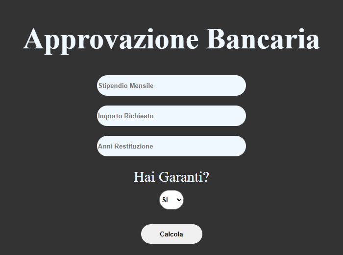

# Approvazione Bancaria

## Descrizione

Ho chiesto all'IA di darmi un esercizio/progetto per allenarmi su tuttò ciò che avevo già imparato bene su Javascript e ciò è saltato fuori.

Una fittizia App Bancaria che permette di gestire i dati del cliente per capire, in base alla politica della propria banca, se approvare o meno un prestito.

Sono presenti le apposite barre per inserire i dati necessari del cliente, compreso un menù a tendina per dichiarare se il cliente ha garante o meno, il tutto calcolato con il classico tasto "Calcola" e subito sotto è presente un display che mostra l'esito, specificando in caso positivo, la Rata Mensile in Euro.

Per rendere subito l'idea di un risultato, ho già inserito dei valori predefiniti che si trovano perfettamente al limite tra approvazione e rifiuto, dove calcolando subito si ottiene l'esito positivo, mentre rimuovendo la presenza del garante si ottiene l'esito negativo.
